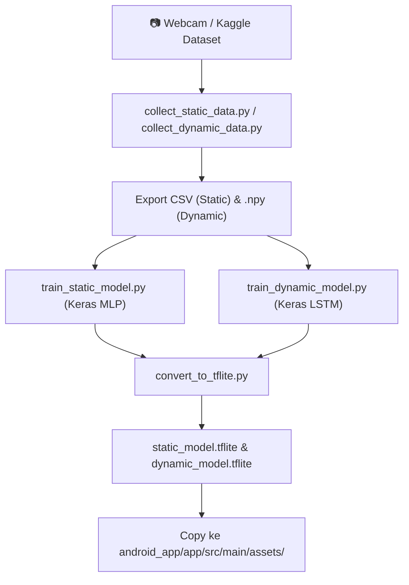

# ⚙️ Technical Code Development Plan (Codebase Level)

**Workspace**: `d:\programming\python\RPL\projectRepo\`  
**Scope**: Petunjuk Eksekusi Kodingan Teknikal (ML Pipeline & Android Native App)

---

## 🛠️ 1. Kontrak Interface & Data Flow Antar Modul

### Kontrak Input Landmark (`FeatureExtractor.kt` ➔ `Classifiers`)
- **Input**: List of 21 `NormalizedLandmark` dari MediaPipe Tasks Vision.
- **Output**: `FloatArray(63)` berisi nilai $(x_{norm}, y_{norm}, z_{norm})$ hasil kalkulasi relatif terhadap Wrist (Landmark 0) dan di-skala dengan ukuran tangan.
- **Sequence Input (LSTM)**: Sliding window / rolling buffer 30 frame berturut-turut berukuran `FloatArray(1890)` (30 × 63).

---

## 🧠 2. Tahapan Eksekusi Sub-System Machine Learning (`ml_pipeline/`)

### Milestone Kunci ML:
1. **Milestone 1**: Generate CSV Alfabet A–Z ➔ Train MLP ➔ Export `static_model.tflite` (Target Akurasi ≥ 90%).
2. **Milestone 2**: Record 150+ sequence dataset 5 kata dinamis MVP ➔ Train LSTM ➔ Export `dynamic_model.tflite` (Target Akurasi ≥ 75%).
3. **Milestone 3**: Tes inferensi `.tflite` via Python script `evaluate_model.py` untuk memastikan output klasifikasi konsisten dengan model Keras asli.

---

## 📱 3. Tahapan Eksekusi Sub-System Android Native (`android_app/`)

### A. Core Module Checklist
- [ ] **`CameraManager.kt`**: Setup CameraX preview & `ImageAnalysis` analyzer pada frame rate 30 FPS.
- [ ] **`HandLandmarkerHelper.kt`**: Inisialisasi MediaPipe Vision Task `hand_landmarker.task` pada mode `LIVE_STREAM`.
- [ ] **`FeatureExtractor.kt`**: Implementasi normalisasi 63 fitur landmark.
- [ ] **`GestureBuffer.kt`**: Buffer antrian melingkar 30 frame sequence.
- [ ] **`StaticClassifier.kt` & `DynamicClassifier.kt`**: Load TFLite model dari assets dan eksekusi `interpreter.run()`.
- [ ] **`TTSManager.kt`**: Integrasi Android Text-to-Speech Bahasa Indonesia dengan mekanisme *debounce*.
- [ ] **`SpeechToTextManager.kt` & `KeywordMatcher.kt`**: Integrasi `SpeechRecognizer` & pemfilteran kata kunci untuk tampilan visual card.

### B. SLA Verification Benchmark
- [ ] End-to-End Latency < 100 ms (diukur menggunakan `System.currentTimeMillis()` dari penerimaan frame kamera hingga pemanggilan `ttsManager.speak()`).
- [ ] Stabil berjalan tanpa memory leak / crash selama 5 menit continuous use.
