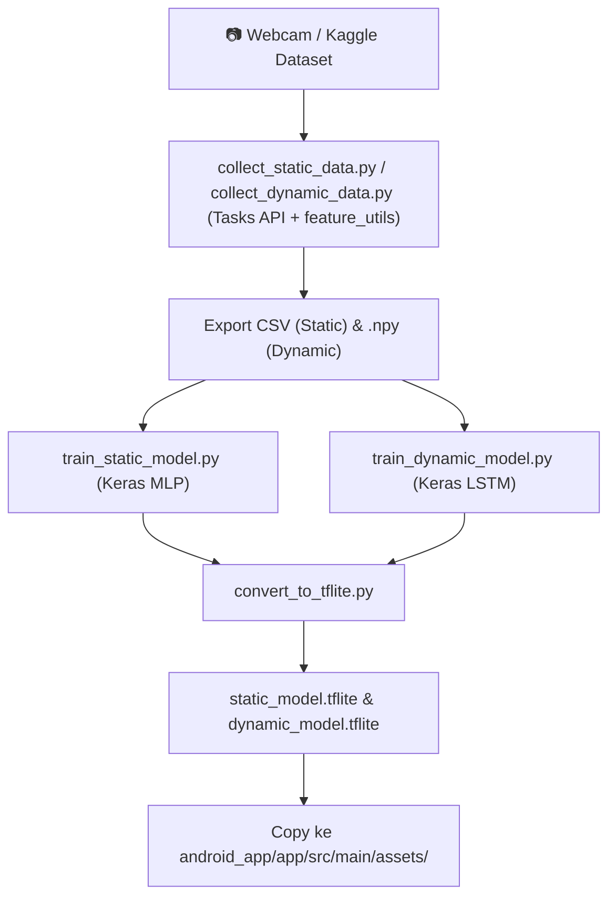

# ⚙️ Technical Code Development Plan (Codebase Level)

**Workspace**: `d:\programming\python\RPL\projectRepo\`  
**Scope**: Petunjuk Eksekusi Kodingan Teknikal (ML Pipeline & Android Native App)

---

## 🛠️ 1. Kontrak Interface & Data Flow Antar Modul

### Kontrak Input Landmark (`FeatureExtractor.kt` ➔ `Classifiers`)
- **Input**: List of 21 `NormalizedLandmark` dari MediaPipe Tasks Vision (`hand_landmarker.task` — **file model yang sama** dipakai di Python & Android).
- **Output**: `FloatArray(63)` berisi nilai $(x_{norm}, y_{norm}, z_{norm})$ hasil kalkulasi relatif terhadap Wrist (Landmark 0) dan di-skala dengan ukuran tangan.
- **Sequence Input (LSTM)**: Sliding window / rolling buffer 30 frame berturut-turut berukuran `FloatArray(1890)` (30 × 63).

### Kontrak Normalisasi (Parity Python ↔ Kotlin)
- **Single source of truth Python**: [`ml_pipeline/feature_utils.py`](ml_pipeline/feature_utils.py) → `normalize_landmarks()`. Semua script `collect_*`/`train_*`/`evaluate_*` **wajib** memakai fungsi ini.
- **Test vector**: [`ml_pipeline/tests/normalization_vectors.json`](ml_pipeline/tests/normalization_vectors.json) (toleransi `1e-5`). Unit test Kotlin `FeatureExtractorTest` wajib lolos terhadap file yang sama.
- Mengubah formula ➔ update Python + Kotlin + `python feature_utils.py --regen` + retrain, **dalam satu PR**.

### Kontrak Label
- [`ml_pipeline/labels/static_labels.txt`](ml_pipeline/labels/static_labels.txt) (A–Z) & [`dynamic_labels.txt`](ml_pipeline/labels/dynamic_labels.txt) (Halo, Terima kasih, Tolong, Ya, Tidak).
- **Urutan baris = indeks output softmax.** File label disalin ke `assets/` bersama `.tflite`; Android membaca label dari file, bukan hardcode.

---

## 🧠 2. Tahapan Eksekusi Sub-System Machine Learning (`ml_pipeline/`)

### Milestone Kunci ML:
1. **Milestone 1**: Generate CSV Alfabet A–Z ➔ Train MLP ➔ Export `static_model.tflite` (Target Akurasi ≥ 90%).
2. **Milestone 2**: Record 150+ sequence dataset 5 kata dinamis MVP ➔ Train LSTM ➔ Export `dynamic_model.tflite` (Target Akurasi ≥ 75%).
3. **Milestone 3**: Tes inferensi `.tflite` via Python script `evaluate_model.py` untuk memastikan output klasifikasi konsisten dengan model Keras asli.

### Environment
- **Python 3.12** (venv `ml_pipeline/.venv`). Verifikasi dengan `python setup_check.py` → harus `ALL CHECKS PASSED`.
- MediaPipe legacy `mp.solutions.hands` sudah dihapus ➔ gunakan `mediapipe.tasks.python.vision.HandLandmarker`.

### Pedoman Konversi LSTM ➔ TFLite (urutan prioritas)
1. **Builtins only** (`OpsSet.TFLITE_BUILTINS`) dengan input shape statis `(1, 30, 63)` — sudah terbukti lolos di `setup_check.py`.
2. `SELECT_TF_OPS` — hanya jika (1) gagal. Konsekuensi: Android wajib menambah dependency `tensorflow-lite-select-tf-ops` (+ belasan MB APK).
3. Ganti arsitektur ke **GRU** atau **Conv1D + GlobalAveragePooling1D**.

### Handoff Model ke Android
`ml_pipeline/assets/hand_landmarker.task`, `models/*.tflite`, `labels/*.txt` ➔ di-commit oleh Danish ➔ di-merge ke `main` ➔ Ahmad `git pull origin main` lalu salin ke `android_app/app/src/main/assets/`.

---

## 📱 3. Tahapan Eksekusi Sub-System Android Native (`android_app/`)

### A. Core Module Checklist
- [ ] **`CameraManager.kt`**: Setup CameraX preview & `ImageAnalysis` analyzer pada frame rate 30 FPS.
- [ ] **`HandLandmarkerHelper.kt`**: Inisialisasi MediaPipe Vision Task `hand_landmarker.task` pada mode `LIVE_STREAM`.
- [ ] **`FeatureExtractor.kt`**: Implementasi normalisasi 63 fitur landmark + unit test terhadap `normalization_vectors.json`.
- [ ] **`GestureBuffer.kt`**: Buffer antrian melingkar 30 frame sequence.
- [ ] **`StaticClassifier.kt` & `DynamicClassifier.kt`**: Load TFLite model dari assets dan eksekusi `interpreter.run()`.
- [ ] **`TTSManager.kt`**: Integrasi Android Text-to-Speech Bahasa Indonesia dengan mekanisme *debounce*.
- [ ] **`SpeechToTextManager.kt` & `KeywordMatcher.kt`**: Integrasi `SpeechRecognizer` & pemfilteran kata kunci untuk tampilan visual card.

### B. SLA Verification Benchmark
- [ ] End-to-End Latency < 100 ms (diukur menggunakan `System.currentTimeMillis()` dari penerimaan frame kamera hingga pemanggilan `ttsManager.speak()`).
- [ ] Stabil berjalan tanpa memory leak / crash selama 5 menit continuous use.
