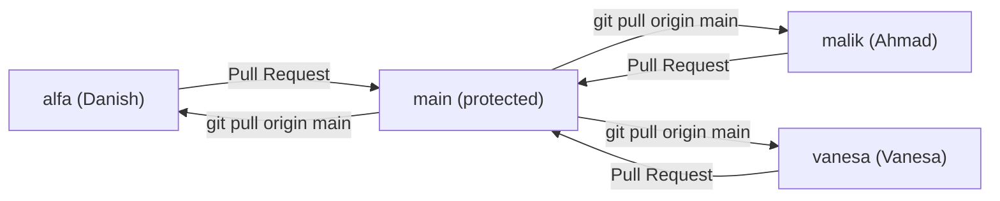

# 🤟 BISINDO Sign-to-Speech — Code Repository

> **Real-Time BISINDO Sign Language Translator Based on Edge AI & Bi-Directional Speech**  
> Rekayasa Perangkat Lunak (RPL) — Teknik Komputer, Universitas Indonesia · Kelompok 5

Aplikasi Android penerjemah BISINDO dua arah yang berjalan **100% offline / on-device**:
- **Arah 1 (Tuli → Dengar)**: CameraX → MediaPipe Hand Landmarker → MLP (alfabet A–Z) & LSTM (5 kata) `.tflite` → Text-to-Speech
- **Arah 2 (Dengar → Tuli)**: SpeechRecognizer (STT) → Keyword Matcher → Teks besar + Visual Card

---

## 👥 Tim & Peran

| Anggota | Peran | Fokus | Branch |
|:---|:---|:---|:---|
| **Danish Al Fayyadh Sunarta** | ML & Data Engineer (Person A) | `ml_pipeline/` | `alfa` |
| **Ahmad Malik Prasetyo** | Android Developer & UI Lead (Person B) | `android_app/` | `malik` |
| **Vanesa Kayla Zahra** | Data Collector, QA & Documentation Support (Person C) | data, QA, `KeywordMatcher` | `vanesa` |

---

## 🗂️ Struktur Repositori

```text
.
├── android_app/            # 📱 Android Native (Kotlin) — dibuat via Android Studio
├── ml_pipeline/            # 🧠 Python ML pipeline (Python 3.12)
│   ├── feature_utils.py    #    Kontrak normalisasi landmark (mirror FeatureExtractor.kt)
│   ├── setup_check.py      #    Verifikasi environment end-to-end
│   ├── labels/             #    Urutan label = indeks output softmax
│   ├── tests/              #    Test vector normalisasi (dipakai unit test Kotlin)
│   ├── assets/             #    hand_landmarker.task (diunduh setup_check.py)
│   ├── data/               #    static/ (CSV, di-commit) · dynamic/ (.npy, via Google Drive)
│   └── models/             #    *.keras & *.tflite final (di-commit)
├── bisindo-web-mockup/     # 🌐 Prototipe web interaktif (Vite) untuk presentasi
├── DEVELOPMENT_PLAN.md     # Kontrak interface & checklist teknis
└── projectDevelopmentContext.md
```

---

## 🚀 Quick Start

### 🧠 ML Pipeline (Danish)
> [!IMPORTANT]
> Wajib **Python 3.10–3.12**. TensorFlow & MediaPipe belum mendukung Python 3.13/3.14.

```powershell
py install 3.12                          # sekali saja (Python Install Manager)
cd ml_pipeline
py -3.12 -m venv .venv
.venv\Scripts\activate
pip install -r requirements.txt
python setup_check.py                    # harus: ALL CHECKS PASSED
```

### 📱 Android App (Ahmad)
1. Install **Android Studio** (stable terbaru).
2. *New Project → Empty Views Activity* di folder `android_app/` — Kotlin, Gradle Kotlin DSL, package `com.signtospeech`, **minSdk 26**.
3. Salin dari `ml_pipeline/`: `assets/hand_landmarker.task`, `models/*.tflite`, `labels/*.txt` → `android_app/app/src/main/assets/`.
4. Unit test `FeatureExtractor` wajib lolos terhadap `ml_pipeline/tests/normalization_vectors.json`.
5. Aktifkan USB debugging di Samsung A30s / Xiaomi 13T → **Run**.

### 🌐 Web Mockup
```powershell
cd bisindo-web-mockup
npm install
npm run dev
```

---

## 🌿 Alur Kerja Git (Branch per Anggota → Pull Request)



```powershell
git switch <branch-anda>          # alfa / malik / vanesa
git pull origin main              # selalu sinkron dengan main sebelum mulai kerja
# ... kerjakan task ...
git add .
git commit -m "feat(ml): train static MLP model"   # format: type(scope): pesan
git push origin <branch-anda>
# Buka Pull Request <branch-anda> → main di GitHub, minta 1 anggota review
```

**Aturan:**
- Jangan push langsung ke `main` — selalu lewat Pull Request.
- Prefix commit: `feat`, `fix`, `docs`, `chore`, `test`, `refactor`. Scope: `ml`, `android`, `mockup`, `docs`.
- Sertakan kode Jira (mis. `KAN-12`) di judul PR bila ada.

---

## 🔁 Handoff Model ML → Android

| Artefak | Sumber (`ml_pipeline/`) | Tujuan (`android_app/app/src/main/assets/`) |
|:---|:---|:---|
| Hand landmark model | `assets/hand_landmarker.task` | `hand_landmarker.task` |
| Model statis | `models/static_model.tflite` | `static_model.tflite` |
| Model dinamis | `models/dynamic_model.tflite` | `dynamic_model.tflite` |
| Label | `labels/static_labels.txt`, `labels/dynamic_labels.txt` | sama |

> [!WARNING]
> Mengubah **urutan label** atau **formula normalisasi** = wajib retrain model, regenerate test vector, dan update Kotlin di PR yang sama.

---

## 📐 Dokumen Spesifikasi
Spesifikasi lengkap ada di repositori dokumentasi [`RPL-sign-to-speech-context`](https://github.com/codename-alfa/RPL-sign-to-speech-context/tree/main/docs/specs):
[01 UML & Arsitektur](https://github.com/codename-alfa/RPL-sign-to-speech-context/blob/main/docs/specs/01_uml_and_architecture.md) ·
[02 ML Pipeline](https://github.com/codename-alfa/RPL-sign-to-speech-context/blob/main/docs/specs/02_ml_pipeline_spec.md) ·
[03 Android App](https://github.com/codename-alfa/RPL-sign-to-speech-context/blob/main/docs/specs/03_android_app_spec.md) ·
[04 Timeline & Risiko](https://github.com/codename-alfa/RPL-sign-to-speech-context/blob/main/docs/specs/04_operational_timeline.md)

**Jira Board**: [Sign-to-Speech (KAN)](https://ahmadmalikprasetyo.atlassian.net/jira/software/projects/KAN/summary) · **Live Demo**: Senin, 7 Desember 2026
