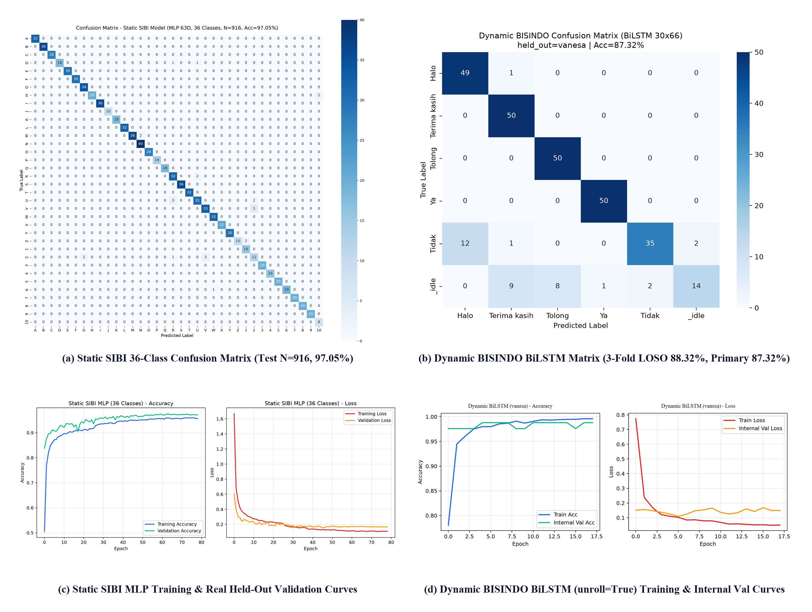
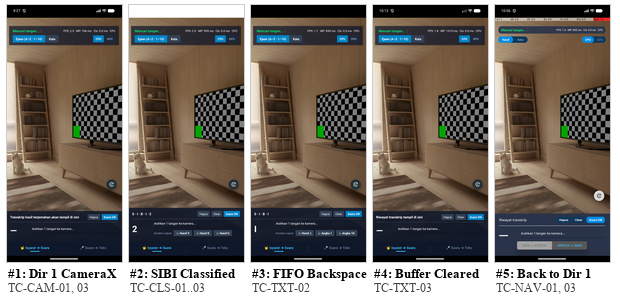
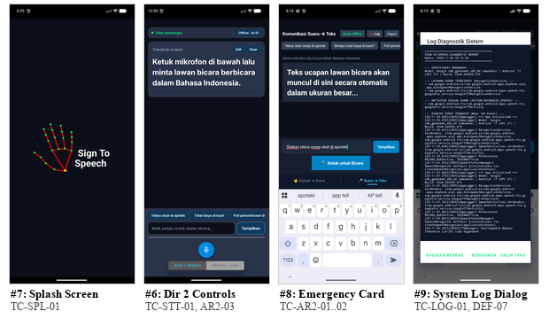
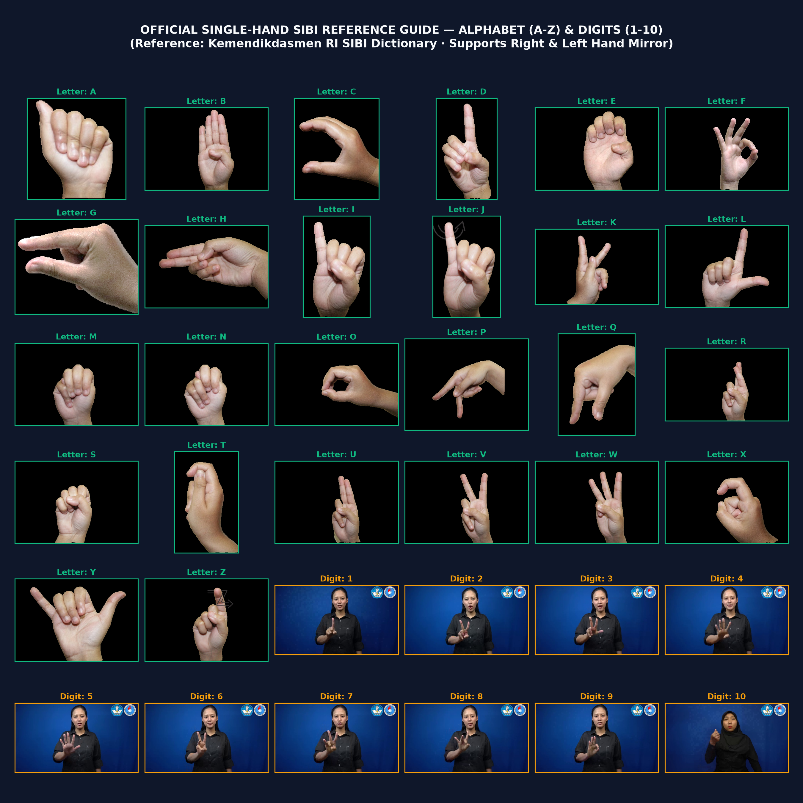

# SOFTWARE TEST DOCUMENTATION (STD) & USER ACCEPTANCE TESTING (UAT) REPORT

**REAL-TIME HYBRID SIBI & BISINDO TRANSLATOR BASED ON EDGE AI & BI-DIRECTIONAL SPEECH (`SignToSpeech v0.6.0`)**

- **Document ID:** `STD-UAT-STS-2026-V0.6`
- **Build Target:** `SignToSpeech v0.6.0` (`versionCode = 6`, Git Commit `6c5a8dd`, Release Tag `v0.6.0`)
- **Prepared By (Second Party / Engineering Team, Group 5):**
  - Ahmad Malik Prasetyo (NPM `2406416270`): Android Lead & Resource Isolation
  - Danish Al Fayyadh Sunarta (NPM `2406416951`): ML Pipeline, Edge TFLite & Architecture
  - Vanesa Kayla Zahra (NPM `2306161901`): NLU Keyword Matching, UI/UX & QA Verification
- **Institution:** Department of Computer Engineering, Faculty of Engineering, Universitas Indonesia, Depok
- **Document Date:** November 2026
- **Standards Alignment:** ISO/IEC/IEEE 29119-3:2021, IEEE 829 (Braude Sec. 28.5), ISO/IEC 25010:2023 (all 9 characteristics including Safety), ISO 9241-11:2018, and Brooke System Usability Scale (SUS)

---

## FRONT MATTER

### Table of Contents
1. Chapter 1: Introduction and Testing Foundations
2. Chapter 2: System Architecture and Test Items
3. Chapter 3: Test Approach, UAT Protocol, and Strategy
4. Chapter 4: Test Environment Specifications
5. Chapter 5: STD Test Case Matrix and Verification Results
6. Chapter 6: User Acceptance Testing (UAT) Framework and Pending Run Status
7. Chapter 7: Conclusion and Conditional Release Sign-Off
8. Chapter 8: Appendix, Evidence Index, and Visual Artifacts

### List of Tables
- Table 1.1: Comparative Analysis of Software Test Documentation (STD) vs. User Acceptance Testing (UAT)
- Table 1.2: Document Control and Revision History (`v0.1.0` to `v0.6.0`)
- Table 2.1: Approved Requirement Change Request (`CR-01`: Hybrid SIBI & BISINDO Scope)
- Table 3.1: Test Deliverables and Milestone Schedule toward Live Demo (December 7, 2026)
- Table 4.1: Hardware, Software, and Instrumentation Test Environment
- Table 5.1: Automated JVM Unit Test Suite Summary (`35` Tests across `10` Suites)
- Table 5.2: On-Device Machine Learning Evaluation (`static_model.tflite` and `dynamic_model.tflite`)
- Table 5.3: 3-Fold Leave-One-Signer-Out (LOSO) Dynamic BiLSTM Breakdown
- Table 5.4: Complete 35 Functional, Integration, Reliability, and Safety Test Case Matrix
- Table 5.5: Requirements Traceability Matrix (MoU, CR-01, and ISO/IEC 25010:2023)
- Table 5.6: Defect and Incident Resolution Log (`DEF-01` to `DEF-14`)
- Table 6.1: Three-Cohort UAT Participant Structure and Pending Rollup Summary
- Table 6.2: ISO 9241-11 Task Completion Protocol (`UAT-01` to `UAT-05`)
- Table 6.3: Six-Item 5-Point Likert Usability Questionnaire Template
- Table 6.4: Ten-Item Standardized Brooke System Usability Scale (SUS) Template
- Table 7.1: Formal Baseline (`v0.5.0`) and Conditional Release (`v0.6.0`) Acceptance Sign-Off
- Table 8.1: Test Repository and Verification Evidence Index

### List of Figures
- Figure 1: Machine Learning Evaluation Summary (Static 36-Class Confusion Matrix, Dynamic BiLSTM 3-Fold LOSO Matrix, Static Learning Curves, and Dynamic BiLSTM Curves)
- Figure 2: Direction 1 (`SIGN -> SPEECH`) CameraX, SIBI Classification, FIFO Backspace, Clear Reset, and Tab Switch Emulator Evidence
- Figure 3: Splash Screen, Direction 2 (`SPEECH -> CARD`) Controls, Emergency Keyword Card, and System Diagnostic Log Viewer Evidence
- Figure 4: Official Single-Hand SIBI Reference Guide (Alphabet A-Z and Digits 1-10, Kemendikdasmen CR-01)

---

## CHAPTER 1: INTRODUCTION AND TESTING FOUNDATIONS

### 1.1 Software Test Documentation Scope (STD / ISO/IEC/IEEE 29119-3:2021)
This Software Test Documentation (STD) and User Acceptance Testing (UAT) report provides traceable verification evidence for `SignToSpeech v0.6.0`, a dual-direction offline Android sign language translator supporting Indonesian Sign System (SIBI) alphabet and digit recognition alongside Indonesian Sign Language (BISINDO) dynamic phrases. Following IEEE 829 (Braude Sec. 28.5) and ISO/IEC/IEEE 29119-3:2021, the STD component validates technical correctness across JVM unit tests, leak-free Python-to-TFLite numerical parity, Android release hardening, and UI control flows.

### 1.2 User Acceptance Testing Framework (UAT / ISO 9241-11:2018)
The UAT component validates real-world utility with actual human stakeholders under ISO 9241-11:2018 criteria (Effectiveness, Efficiency, Satisfaction) and Brooke System Usability Scale (SUS) scoring prior to the scheduled December 7, 2026 live demonstration. All UAT tables in `v0.6.0` are intentionally clean and marked `PENDING_UAT_RUN` until multi-cohort field data collection completes, eliminating synthetic or placeholder acceptance scores from earlier drafts.

### 1.3 Comparative Analysis: STD vs. UAT

| Comparison Dimension | Software Test Documentation (STD) | User Acceptance Testing (UAT) |
| :--- | :--- | :--- |
| Core Question Addressed | Does the built Android system satisfy engineering specs and numerical parity? | Does the live application solve communication needs smoothly for Deaf and hearing users? |
| Governing Standards | ISO/IEC/IEEE 29119-3:2021, IEEE 829 / Braude Sec. 28.5 | ISO 9241-11:2018, ISO/IEC 25010:2023 (Interaction & Safety), Brooke SUS |
| Execution Environment | Host Python/TensorFlow, Gradle JVM (`35` tests), AVD API 37, target phones | Real public-service simulation (clinic counter, campus reception, offline trials) |
| Primary Evaluators | Engineering Team (Group 5) automated suites & verification logs | Group 1 Client (`N=1`), Group 2 Internal (`N=3`), Group 3 External (`N=18`) |
| Current `v0.6.0` Status | Technical checks passed (`35/35` JVM, `0` parity mismatches, AVD verified); 7 live hardware cases `PENDING_PHYSICAL_RUN` | Framework & Excel formulas ready; field data `PENDING_UAT_RUN` before Dec 7, 2026 demo |

### 1.4 Standards and Regulatory References
1. ISO/IEC/IEEE 29119-3:2021, Software and systems engineering, Software testing Part 3: Test documentation.
2. IEEE Std 829-2008 / Braude Section 28.5, Software Test Documentation structure and defect incident taxonomy.
3. ISO/IEC 25010:2023, Systems and software Quality Requirements and Evaluation (SQuaRE) product quality model covering all 9 characteristics: Functional Suitability, Performance Efficiency, Compatibility, Interaction Capability, Reliability, Security, Maintainability, Flexibility, and Safety.
4. ISO 9241-11:2018, Ergonomics of human-system interaction, Part 11: Usability definitions and measures.
5. Brooke, J. (1996), SUS: A "Quick and Dirty" Usability Scale, Usability Evaluation in Industry.
6. Memorandum of Understanding (MoU), Sign-to-Speech Mobile Application Collaboration (First Party: Raihan Muhammad Nafis Al-Kautsar, Second Party: Group 5 Computer Engineering UI, October 15, 2026).

### 1.5 Document Control and Revision History

| Version | Date | Commit / Artifact ID | Lead Author | Summary of Changes |
| :--- | :--- | :--- | :--- | :--- |
| `v0.3.0` | Nov 2026 | `SignToSpeech-v0.3.0-bidirectional.apk` | Group 5 UI | Initial bidirectional APK, `DelegateGuard`, 26 JVM unit tests |
| `v0.4.0` | Nov 2026 | `SignToSpeech-v0.4.0-sibi.apk` | Group 5 UI | Migrated Direction 1 static classifier from two-hand BISINDO to 36-class SIBI (`CR-01`) |
| `v0.5.0` | Nov 12, 2026 | `SignToSpeech-v0.5.0.apk` | Group 5 UI | Added System Log Viewer, Quick Presets, 33 unit tests, initial baseline STD & UAT |
| `v0.6.0` | Nov 20, 2026 | `6c5a8dd` / `SignToSpeech-v0.6.0.apk` | Group 5 UI | Leak-free SIBI 70/15/15 split (`97.05%` real test), upgraded dynamic model to true `Bidirectional(LSTM(32, unroll=True))` (`TFLITE_BUILTINS`, 3-fold LOSO `88.32%`), front camera default, `SecurityException` keyboard focus, Emergency IGD chip, `BuildConfig.DEBUG` guard, rotation state retention, `35` unit tests, `35` TCs, ISO 25010:2023, and clean `PENDING_UAT_RUN` 3-group workbook |

---

## CHAPTER 2: SYSTEM ARCHITECTURE AND TEST ITEMS

### 2.1 Component Architecture (`SignToSpeech v0.6.0`)
SignToSpeech runs 100% locally on Android (`minSdk = 26`, `targetSdk = 34`, `arm64-v8a` & `armeabi-v7a`) using MediaPipe Hand Landmarker (`hand_landmarker.task`) and TensorFlow Lite flatbuffers:
- Direction 1 (`SIGN -> SPEECH`): `CameraManager` binds `CameraX` (`LENS_FACING_FRONT` default in `v0.6.0`) to capture live frames, extracts 21 3D hand landmarks, normalizes isotropic 63D coordinates (`FeatureExtractor`), and dispatches either Letter Mode (`static_model.tflite`, 36-class SIBI MLP) or Word Mode (`GestureBuffer` 1500 ms sliding window -> `DynamicFeatureBuilder` 30x66 tensor -> `dynamic_model.tflite`, `Bidirectional(LSTM(32, unroll=True))` for `Halo`, `Terima kasih`, `Tolong`, `Ya`, `Tidak`, `_idle`). Committed tokens pass `PredictionStabilizer` (`>= 70%` confidence, `_idle` block, 2000 ms cooldown) and trigger `TTSManager` Indonesian voice synthesis (`id-ID`, 1200 ms debounce).
- Direction 2 (`SPEECH -> CARD`): `SpeechToTextManager` manages Android `SpeechRecognizer` with streaming partial transcripts, RMS dB progress normalization (`SpeechToTextManager.normalizeRmsDb`), offline-first fallback on error `12/13`, and automatic inline keyboard focus (`TextCardDisplay.focusKeyboardInput()`) whenever OEM ROMs raise `SecurityException` (`ERROR_SECURITY_EXCEPTION = -1`). `KeywordMatcher` highlights 9 public-service categories (`OBAT`, `DOKTER`, `DARURAT`, `KASIR`, `TRANSPORTASI`, `ARAH`, `PENDAFTARAN`, `BANTUAN`, `SAPAAN`) and exposes 6 one-tap Quick Presets including Emergency IGD.
- State & Build Safety (`v0.6.0`): `MainActivity` implements `onSaveInstanceState` / `restoreUiState` across activity recreation without duplicating TTS speech, guards `debug_*` test extras strictly behind `BuildConfig.DEBUG`, and removes legacy unused `BLACKLISTED_STT_PACKAGES`.

### 2.2 Features to Be Tested
1. Leak-free static SIBI 36-class MLP generalization (`916` unseen real test samples) and float32 TFLite parity.
2. Dynamic BISINDO `Bidirectional(LSTM(32, unroll=True))` pure `TFLITE_BUILTINS` conversion, 3-fold LOSO cross-signer generalization, and parity across all 874 takes.
3. Front camera initialization (`LENS_FACING_FRONT`), camera lens switching, and `DelegateGuard` crash protection.
4. FIFO transcript queue (`MAX_TRANSCRIPT_ITEMS = 12`), single-item backspace, full clear, and confusion-pair correction pills.
5. `TTSManager.shouldSpeak` debouncing and immediate mute gating.
6. Direction 2 microphone toggle, `SecurityException` keyboard auto-focus fallback, 9 keyword categories, and all 6 Quick Presets including Emergency IGD.
7. Screen rotation / Activity recreation state retention, `BuildConfig.DEBUG` release guard, diagnostic log sharing, and ISO/IEC 25010:2023 Safety behavior.

### 2.3 Features Not Tested in Automated Runs
1. Cloud backend account sync (excluded intentionally; the architecture is offline-only with zero server storage).
2. Continuous multi-hour battery drain profiling across physical handset families (`PENDING_PHYSICAL_RUN`).
3. Regional dialects outside standard SIBI single-hand shapes and the 5 BISINDO dynamic phrases.

### 2.4 Approved Requirement Change Request (`CR-01`)

| Recognition Mode | Initial MoU Scope (Oct 15, 2026) | Approved `CR-01` Scope | Engineering & Ergonomic Rationale | Status |
| :--- | :--- | :--- | :--- | :--- |
| Static Characters | Two-handed regional BISINDO letters | Single-handed SIBI 36 classes (`A-Z`, `1-10`, Kemendikdasmen) | Enables one-handed smartphone holding while signing into the front camera | Approved & Verified (`v0.4.0-v0.6.0`) |
| Dynamic Words | Continuous BISINDO phrases | 5 functional phrases (`Halo`, `Terima kasih`, `Tolong`, `Ya`, `Tidak`) + `_idle` | Eliminates phantom triggers via BiLSTM temporal modeling across 3 signers | Upgraded (`v0.6.0` BiLSTM) |

---

## CHAPTER 3: TEST APPROACH, UAT PROTOCOL, AND STRATEGY

### 3.1 Four-Tier Testing Levels
1. Tier 1 (JVM Unit Tests): Runs via `./gradlew.bat testDebugUnitTest --rerun-tasks` without emulator boot overhead (`35` tests across `10` JUnit classes covering feature math, stabilizer logic, `DelegateGuard`, keyword extraction, STT helpers, and TTS playback gating).
2. Tier 2 (ML Parity & LOSO Cross-Validation): Automated Python/TensorFlow evaluation comparing `.keras` vs `.tflite` predictions across `916` static unseen real samples and `284` / `874` dynamic BiLSTM sequences.
3. Tier 3 (Android Emulator & ADB Integration): Functional workflow verification across Android 17 Emulator (AVD API 37 `x86_64`) and `capture_v060_evidence.py` script instrumentation.
4. Tier 4 (Physical Hardware & 3-Group Field UAT): Scheduled hardware verification on Redmi Pad 2, Samsung Galaxy A30s, Xiaomi 15 (`PENDING_PHYSICAL_RUN`), plus `N=22` 3-group UAT sessions (`PENDING_UAT_RUN`) prior to December 7, 2026.

### 3.2 Pass and Fail Criteria
- Automated JVM Suites: `100%` pass rate (`0` failures, `0` errors, `0` skipped).
- TFLite Conversion & Parity: `100%` `TFLITE_BUILTINS` compatibility (`0` `SELECT_TF_OPS`), `0` argmax mismatches, max probability delta `< 1e-4`.
- Dynamic LOSO Generalization Gate: 3-fold LOSO mean accuracy and primary held-out accuracy `>= 80.0%`.
- Physical Device / Field UAT Acceptance: Mean ISO 9241-11 task completion `>= 80%`, Group 1 Client & Group 3 External Likert mean `>= 4.00 / 5.00`, Brooke SUS mean `>= 68.0`.

### 3.3 Suspension and Resumption Rules
Testing suspends immediately if an unhandled exception crashes CameraX or MediaPipe native JNI initialization (`DelegateGuard` auto-blocks GPU and falls back to CPU on next launch), or if a model export requires `SELECT_TF_OPS` Flex runtime dependencies. Testing resumes once root cause remediation and parity re-verification complete.

### 3.4 Standardized Field UAT Execution Script (Chapter 3 Protocol)
Each UAT session follows an uncoached 15-minute protocol recorded in `TEMPLATE_FORM_UAT_18_USERS.md` and `DOKUMEN_PENGUJIAN_SISTEM_SIGNTOSPEECH.xlsx`:
1. Equipment Check: Confirm Android 8.0+ handset runs `SignToSpeech v0.6.0`, verify offline Airplane Mode toggle works, and place printed Figure 4 SIBI chart beside novice users.
2. Briefing (2 min): Inform participant that video and audio remain 100% local with zero cloud upload and withdrawal is permitted anytime. Avoid coaching finger posture during timed runs.
3. Timed ISO 9241-11 Tasks (`UAT-01` to `UAT-05`): Measure Pass/Fail (1/0) and elapsed seconds per task (`HALO` static spelling, `Terima kasih` + 3s `_idle` hold, Direction 2 Emergency IGD card + keyboard fallback, Airplane-mode verification, and screen rotation recovery).
4. Post-Task Scales (5 min): Collect 6-item Likert ratings (1-5) and 10-item Brooke SUS ratings immediately after tasks, separating Cohort Group 1 (`N=1` client), Group 2 (`N=3` internal calibration target `83-87%` / `4.15-4.35`), and Group 3 (`N=18` external respondents).

### 3.5 Test Deliverables and Milestone Schedule

| Phase / Milestone | Deliverable Artifact | Responsible Lead | Target Window | Current Status |
| :--- | :--- | :--- | :--- | :--- |
| M1: ML Pipeline Upgrade | Leak-free static MLP + BiLSTM 3-fold LOSO & parity reports | Danish | Nov 18-20, 2026 | Completed (`6c5a8dd`) |
| M2: Android `v0.6.0` Hardening | APK `v0.6.0`, UX fixes, `BuildConfig.DEBUG` guard, 35 unit tests | Ahmad | Nov 19-20, 2026 | Completed (`35/35` PASS) |
| M3: ADB Scripts & Docs Sync | `capture_v060_evidence.py`, 35-TC Excel, English STD/DOCX/Google Doc | Vanesa & Team | Nov 20, 2026 | Completed (Docs Synced) |
| M4: Physical Phone Benchmarks | Xiaomi 15, Redmi Pad 2, Galaxy A30s FPS & Airplane-mode logs | Ahmad & Vanesa | Nov 21-Dec 1, 2026 | `PENDING_PHYSICAL_RUN` |
| M5: Field UAT & Live Demo | Group 1-3 UAT sheets populated & Dec 7, 2026 live presentation | Group 5 & Client | Nov 25-Dec 7, 2026 | `PENDING_UAT_RUN` |

### 3.6 Testing Risks, Assumptions, and Limitations
1. Single-Fold `_idle` Variance in Cross-Signer LOSO: While 3-fold mean `_idle` recall improved from baseline `52.94%` to `61.87%` (`59.82%` OOF across `N=874`, with `ahmad` at `100.00%`), held-out fold `vanesa` scored `41.18%` (`14 / 34`) on `_idle` takes because slow resting hand drifts overlap temporally with active gestures (`Terima kasih` / `Tolong`). Runtime mitigation enforces `PredictionStabilizer`'s `>= 70%` sustained confidence gate and explicit `_idle` veto before speaking.
2. Emulator Frame Rate vs. Physical NPU/GPU: AVD API 37 executes ARM64 MediaPipe libraries through `ndk_translation` (`1.6-2.9 FPS`), whereas physical Snapdragon hardware measurements remain `PENDING_PHYSICAL_RUN`.
3. Deferred UAT Population: UAT scores remain blank (`PENDING_UAT_RUN`) so live human usability trials occur on the final `v0.6.0` build rather than reusing stale mock or v0.5.0 figures.

---

## CHAPTER 4: TEST ENVIRONMENT SPECIFICATIONS

| Environment Parameter | Specification (`v0.6.0` Verification) |
| :--- | :--- |
| Application Package & Version | `com.signtospeech`, `versionName = "0.6.0"`, `versionCode = 6` |
| APK Assets Included | `SignToSpeech-v0.6.0.apk` (`47,335,222` bytes debug APK), `app-release-unsigned.apk` (`45,472,779` bytes) |
| Target Android SDK Range | `minSdk = 26` (Android 8.0) to `targetSdk = 34` (Android 14); verified up to AVD API 37 (Android 17 preview) |
| Supported Native ABIs | `arm64-v8a`, `armeabi-v7a` (`hand_landmarker.task` + TFLite C++ runtime) |
| Emulator Verification Host | Windows 11 x64, JDK 17.0.12, Gradle 8.x, TensorFlow 2.21.0 (`ml_pipeline/.venv`), AVD `sdk_gphone64_x86_64` |
| Static ML Asset Digest | `static_model.tflite` (`75.98 KB`, SHA256 `5bded82e20b34ac80f468c2e106e7335081336855e3c9875207549992dddf4d9`) |
| Dynamic ML Asset Digest | `dynamic_model.tflite` (`298.14 KB`, SHA256 `8025db2d869112057cb8c4ea501e80ebf2af24ca2da43454c0132f478d6f8807`) |
| Scheduled Physical Devices | Xiaomi Redmi Pad 2, Samsung Galaxy A30s, Xiaomi 15 (`PENDING_PHYSICAL_RUN`) |

---

## CHAPTER 5: STD TEST CASE MATRIX AND VERIFICATION RESULTS

### 5.1 Automated JVM Unit Testing Summary (`35` Tests Across `10` Suites)
Executed after final code and asset edits via `./gradlew.bat testDebugUnitTest --rerun-tasks`:

| Suite (`com.signtospeech.*`) | Tests | Failures | Errors | Skipped | Time (s) | Verified Responsibility |
| :--- | :---: | :---: | :---: | :---: | :---: | :--- |
| `mediapipe.DelegateGuardTest` | 6 | 0 | 0 | 0 | 0.006 | Emulator GPU lock, native crash sentinel, long-press reset |
| `ml.DynamicFeatureBuilderTest` | 1 | 0 | 0 | 0 | 0.132 | Cross-language 30x66 temporal resampling & velocity parity |
| `ml.FeatureExtractorTest` | 3 | 0 | 0 | 0 | 0.041 | 63D hand landmark extraction & null/partial bounds |
| `ml.GestureBufferTest` | 2 | 0 | 0 | 0 | 0.011 | 1500 ms sliding window trimming & 300 ms max gap eviction |
| `ml.ModelSpaceTest` | 1 | 0 | 0 | 0 | 0.005 | Wrist-origin isotropic normalization parity against Python JSON |
| `ml.PredictionStabilizerTest` | 4 | 0 | 0 | 0 | 0.017 | Confidence >=70% commit gate, `_idle` veto, 2000 ms cooldown |
| `speech.KeywordMatcherTest` | 10 | 0 | 0 | 0 | 0.030 | 9 keyword categories, suffix matching, 6 presets incl. IGD |
| `speech.SpeechToTextHelperTest` | 3 | 0 | 0 | 0 | 0.005 | `normalizeRmsDb`, `ERROR_SECURITY_EXCEPTION = -1`, ID error messages |
| `speech.TTSManagerLogicTest` | 2 | 0 | 0 | 0 | 0.004 | `shouldSpeak` mute/blank/`_idle` blocking and 1200 ms debounce |
| `ui.HapticFeedbackHelperTest` | 3 | 0 | 0 | 0 | 0.003 | Tactile pulse durations for commit, switch, and delete actions |
| **TOTAL** | **35** | **0** | **0** | **0** | **0.254** | **100% Automated JVM Pass** |

### 5.2 Machine Learning Evaluation and TFLite Parity

| Evaluation Dimension | Static SIBI Classifier (`static_model.tflite`) | Dynamic BISINDO Classifier (`dynamic_model.tflite`) |
| :--- | :--- | :--- |
| Architecture | MLP (`63 -> 128 -> BN -> 64 -> 36`), 19,300 total (19,044 trainable) params | `Bidirectional(LSTM(32, unroll=True)) -> Dropout(0.25) -> Dense(32) -> Dense(6)`, 27,622 params |
| TFLite Op Runtime & Size | `TFLITE_BUILTINS`, `75.98 KB` float32 | Strictly `TFLITE_BUILTINS` only (`zero SELECT_TF_OPS`), `298.14 KB` float32 |
| Dataset Curation & Split | 3,053 unique canonical real samples (70/15/15 split); train-only 3D aug -> 18,000 train, 916 real val, 916 real test | 874 raw takes across 3 signers (`Halo` 150, `Terima kasih` 150, `Tolong` 155, `Ya` 153, `Tidak` 154, `_idle` 112) |
| Primary Unseen Accuracy | `97.05%` bilateral test (`97.16%` canonical `458`, `96.94%` mirror `458`; best val `97.60%` Epoch 64) | `87.32%` primary held-out (`vanesa`, `N=284`); **3-fold LOSO mean `88.32%`** (`88.22%` OOF, `N=874`) |
| Macro Precision / F1 / `_idle` | Macro Precision `0.9689`, Macro Recall `0.9688`, Macro F1 `0.9679` | 3-fold Mean Macro F1 `0.8689`; Mean `_idle` Recall `61.87%` (`59.82%` OOF; `41.18%` on `vanesa`) |
| Keras vs TFLite Parity | `0 / 916` mismatches (`100.00%` agreement), max diff `1.40e-6`, `0.0111 ms/frame` | `0 / 284` held-out mismatches (`0.2011 ms`) & `0 / 874` all-takes mismatches (`0.1444 ms`), max diff `2.98e-7` |

Dynamic BiLSTM 3-Fold Leave-One-Signer-Out Breakdown (Table 5.3):

| LOSO Fold Held-Out Signer | Test Sequences (`N`) | Fold Accuracy | Macro Precision | Macro F1 | `_idle` Recall | Held-Out Loss |
| :--- | :---: | :---: | :---: | :---: | :---: | :---: |
| Fold 1: `ahmad` | 281 | 92.53% | 0.9251 | 0.9215 | 100.00% | 0.4636 |
| Fold 2: `danish` | 309 | 85.11% | 0.8406 | 0.8412 | 44.44% | 0.4885 |
| Fold 3: `vanesa` (Primary) | 284 | 87.32% | 0.8811 | 0.8441 | 41.18% | 0.7914 |
| **3-Fold Mean / OOF Aggregate** | **874 total** | **88.32% Mean (`88.22%` OOF)** | **0.8823** | **0.8689** | **61.87% Mean (`59.82%` OOF)** | **0.5812** |

*Figure 1. Machine Learning Evaluation Artifacts: (a) 36-Class Unseen Static SIBI Confusion Matrix (`N=916`, `97.05%`), (b) Dynamic BiLSTM `vanesa` Held-Out Matrix (`87.32%`, 3-Fold Mean `88.32%`), (c) Static MLP Learning Curves, and (d) Dynamic BiLSTM Learning Curves.*

### 5.3 Complete 35 Functional, Integration, Reliability, and Safety Test Case Matrix

| ID | Feature Area | Test Scenario | Expected Outcome | Actual Result / Evidence | Status |
| :--- | :--- | :--- | :--- | :--- | :--- |
| `TC-SPL-01` | Splash & Launch | Cold launch displays custom overlay | SignToSpeech emblem renders and fades after 1100 ms | Verified on AVD API 37 | `PASS (AVD API 37)` |
| `TC-CAM-01` | CameraX & Permissions | Grant/deny CAMERA runtime permission | Rationale shown; CameraX binds upon permission grant | Verified on AVD API 37 | `PASS (AVD API 37)` |
| `TC-CAM-02` | CameraX Controls | Switch camera button toggles lens | Lens switches cleanly; `OverlayView` & buffer reset | Verified overlay reset on AVD | `PASS (AVD API 37)` |
| `TC-CAM-03` | Front Camera Default (`v0.6.0`) | Launch app fresh on phone | `CameraManager` opens on `LENS_FACING_FRONT` | Compiled; live phone test queued | `PENDING_PHYSICAL_RUN` |
| `TC-DEL-01` | `DelegateGuard` (AVD) | Launch on Android Emulator | GPU locked cleanly with emulator message | Verified (`DelegateGuardTest` + AVD) | `PASS (AVD API 37)` |
| `TC-DEL-02` | `DelegateGuard` (Hardware) | Switch `CPU->GPU->CPU` & crash recovery | 5x switch safe; crash blocks GPU + shows Snackbar | Physical handset test queued | `PENDING_PHYSICAL_RUN` |
| `TC-MOD-01` | Mode Toggle | Toggle Letter (`SIBI`) vs Word (`BISINDO`) | Sliding buffer resets and switches classifier | Verified on AVD API 37 | `PASS (AVD API 37)` |
| `TC-SIBI-01` | Static SIBI Unseen Test | Evaluate 36 classes on `N=916` test split | Unseen accuracy `>= 90%`, leak-free split | `97.05%` bilat (`97.16%` canon.) | `PASS (JVM / Host Parity)` |
| `TC-SIBI-02` | Static TFLite Parity | Keras vs `static_model.tflite` on `916` samples | `0` argmax mismatches, max diff `< 1e-4` | `0/916` mismatches, diff `1.40e-6` | `PASS (JVM / Host Parity)` |
| `TC-SIBI-03` | Isotropic Normalization | Translate to wrist & scale by palm length | Output invariant to viewport position/scale | Verified in `FeatureExtractorTest` | `PASS (JVM / Host Parity)` |
| `TC-SIBI-04` | Bilateral Symmetry | Classify right-hand and mirrored left-hand shapes | Left-hand mirror accuracy `>= 95%` | `96.94%` on `458` mirrored shapes | `PASS (JVM / Host Parity)` |
| `TC-SIBI-05` | Alphabet Spelling Queue | Spell `H-A-L-O` into bottom transcript bar | Letters append cleanly with suggestion chips | Verified on AVD API 37 | `PASS (AVD API 37)` |
| `TC-DYN-01` | BiLSTM Builtins (`v0.6.0`) | Export `Bidirectional(LSTM(32, unroll=True))` | Zero `SELECT_TF_OPS` Flex runtime ops | Pure `TFLITE_BUILTINS` (`298.14 KB`) | `PASS (JVM / Host Parity)` |
| `TC-DYN-02` | 3-Fold LOSO CV (`v0.6.0`) | Validate held-out folds (`ahmad`, `danish`, `vanesa`) | 3-fold mean & held-out accuracy `>= 80%` | Mean `88.32%`, OOF `88.22%` | `PASS (JVM / Host Parity)` |
| `TC-DYN-03` | Dynamic Parity (`v0.6.0`) | Keras vs `dynamic_model.tflite` on held-out & all takes | `0` argmax mismatches across all sequences | `0/284` & `0/874` (`0.1444 ms`) | `PASS (JVM / Host Parity)` |
| `TC-DYN-04` | `_idle` Veto & Stabilizer | Filter rest motions & `< 70%` transient predictions | `_idle` never speaks; cooldown prevents spam | Verified (`PredictionStabilizerTest`) | `PASS (JVM / Host Parity)` |
| `TC-DYN-05` | Live BISINDO Phrases | Perform 5 words + 30s idle on physical phone | `>= 4/5` per word, `<= 1` phantom speech | Physical handset test queued | `PENDING_PHYSICAL_RUN` |
| `TC-TXT-01` | FIFO Queue Bound | Commit `> 12` tokens into transcript deque | Enforces `MAX_TRANSCRIPT_ITEMS = 12` | Verified on AVD API 37 | `PASS (AVD API 37)` |
| `TC-TXT-02` | Single Backspace (`Hapus`) | Delete tail item from transcript queue | Tail removed cleanly; stabilizer updates | Verified on AVD API 37 | `PASS (AVD API 37)` |
| `TC-TXT-03` | Clear & Quick Correction | Clear transcript or tap SIBI pair suggestion | Clears deque or replaces tail character | Verified on AVD API 37 | `PASS (AVD API 37)` |
| `TC-TTS-01` | TTS Debounce (`1200 ms`) | Guard duplicate TTS triggers within 1200 ms | Duplicate skipped unless `force=true` | Verified in `TTSManagerLogicTest` | `PASS (JVM / Host Parity)` |
| `TC-TTS-02` | TTS Mute Gate | Enable `Suara MUTE` during active translation | UI updates while audio stays silent | Verified in `TTSManagerLogicTest` | `PASS (JVM / Host Parity)` |
| `TC-STT-01` | Dir 2 Mic & RMS Meter | Tap mic button and inspect RMS bar & badge | RMS normalized `0..100%`; offline badge works | Verified AVD + `SpeechToTextHelperTest` | `PASS (AVD API 37)` |
| `TC-STT-02` | `SecurityException` Focus (`v0.6.0`) | Trigger STT `SecurityException` (error `-1`) | Toast alert + inline keyboard auto-focused | Constant tested; OEM test queued | `PENDING_PHYSICAL_RUN` |
| `TC-AR2-01` | 9-Category Keyword Match | Highlight medical/transit phrases & cards | All 9 hex colors & Indonesian suffixes match | Verified in `KeywordMatcherTest` (10) | `PASS (JVM / Host Parity)` |
| `TC-AR2-02` | Inline Keyboard Submit | Submit typed phrase via soft keyboard | Highlights + cards appear; IME hides cleanly | Verified on AVD API 37 | `PASS (AVD API 37)` |
| `TC-AR2-03` | Standard Quick Presets | Tap public-service quick preset chips (1-5) | Fills input field & highlights chip | Verified on AVD API 37 | `PASS (AVD API 37)` |
| `TC-AR2-04` | Emergency IGD Preset (`v0.6.0`) | Tap 6th preset chip (`Kondisi darurat IGD`) | Renders `DARURAT` red emergency visual card | `KeywordMatcherTest` pass; UI queued | `PENDING_PHYSICAL_RUN` |
| `TC-NAV-01` | Direction Pill & Isolation | Switch `SIGN -> SPEECH` <-> `SPEECH -> CARD` | Pauses CameraX/TTS on Dir 2; resumes on Dir 1 | Verified on AVD API 37 | `PASS (AVD API 37)` |
| `TC-NAV-02` | Circular Action Geometry | Inspect circular camera, mic, delete, clear, mute | Zero label clipping or distorted bounds | Verified on AVD API 37 | `PASS (AVD API 37)` |
| `TC-REL-01` | Rotation State Retention (`v0.6.0`) | Rotate screen or recreate Activity mid-session | Direction, mode, transcript, mute & card restore | Implemented; live rotation queued | `PENDING_PHYSICAL_RUN` |
| `TC-REL-02` | `BuildConfig.DEBUG` Guard | Send `debug_*` extras to release APK | Release ignores debug extras & fades splash | Verified `assembleRelease` build | `PASS (JVM / Host Parity)` |
| `TC-LOG-01` | In-App Diagnostic Log | Open system log viewer, copy & share report | Displays buffer and launches Share Sheet | Verified on AVD screenshot `#9` | `PASS (AVD API 37)` |
| `TC-SAF-01` | ISO 25010 Safety Controls | Verify Emergency red alert & `_idle` suppression | Red `#EF4444` urgent alert; no `_idle` speech | Verified via JUnit safety checks | `PASS (JVM / Host Parity)` |
| `TC-SAF-02` | Airplane Mode Privacy | Execute signs, cards, and TTS with radios off | Zero outbound traffic or offline failure | Scheduled on physical phones | `PENDING_PHYSICAL_RUN` |

### 5.4 Requirements Traceability Matrix (MoU + CR-01 + ISO/IEC 25010:2023)

| Req ID | Source / Standard | Quality Characteristic | Unit Verification | STD Test Cases | Status |
| :--- | :--- | :--- | :--- | :--- | :--- |
| `REQ-01` | MoU Art. 1 & 2, `CR-01` | Functional Suitability | `FeatureExtractorTest`, `ModelSpaceTest`, `PredictionStabilizerTest` | `TC-SIBI-01..05`, `TC-DYN-01..05` | Verified (ML+Unit) / `PENDING_PHYSICAL_RUN` |
| `REQ-02` | MoU Art. 1 & 2 | Functional Suitability | `KeywordMatcherTest`, `SpeechToTextHelperTest` | `TC-STT-01..02`, `TC-AR2-01..04` | Verified (Unit+AVD) / `PENDING_PHYSICAL_RUN` |
| `REQ-03` | ISO/IEC 25010:2023 | Performance Efficiency | `DynamicFeatureBuilderTest`, `GestureBufferTest` | `TC-SIBI-02`, `TC-DYN-03`, `TC-TXT-01` | Verified (Host `<1ms`) / `PENDING_PHYSICAL_RUN` |
| `REQ-04` | ISO/IEC 25010:2023 | Compatibility | `DelegateGuardTest` | `TC-CAM-01..03`, `TC-DEL-01..02` | Verified (AVD) / `PENDING_PHYSICAL_RUN` |
| `REQ-05` | ISO 25010:2023 / 9241-11 | Interaction Capability | `KeywordMatcherTest`, `HapticFeedbackHelperTest` | `TC-AR2-03..04`, `TC-NAV-02` | `PENDING_UAT_RUN` |
| `REQ-06` | ISO/IEC 25010:2023 | Reliability | `DelegateGuardTest`, `SpeechToTextHelperTest` | `TC-DEL-01`, `TC-STT-02`, `TC-REL-01` | Verified (Unit+AVD) / `PENDING_PHYSICAL_RUN` |
| `REQ-07` | ISO/IEC 25010:2023 | Security | Release `BuildConfig.DEBUG` guard | `TC-REL-02`, `TC-LOG-01` | Verified (Release Build) |
| `REQ-08` | ISO/IEC 25010:2023 | Maintainability & Flexibility | 10 JVM test suites, Python parity tests | `TC-SIBI-02`, `TC-DYN-01..03` | Verified |
| `REQ-09` | ISO/IEC 25010:2023 | **Safety** (Urgent Alerts, Zero Phantom TTS, Local Privacy) | `TTSManagerLogicTest`, `PredictionStabilizerTest`, `KeywordMatcherTest` | `TC-DYN-04`, `TC-AR2-04`, `TC-SAF-01..02` | Verified (Logic) / `PENDING_PHYSICAL_RUN` |

### 5.5 Defect and Incident Resolution Log (`DEF-01` to `DEF-14`)

| ID | Severity | Component / Scope | Observed Symptom / Root Cause | Resolution Implemented | Status |
| :--- | :--- | :--- | :--- | :--- | :--- |
| `DEF-01` | High | `DelegateGuard` (AVD) | OpenGL SIGSEGV on x86_64 emulator startup | Added emulator fingerprint lock & atomic crash blocklist | Resolved |
| `DEF-02` | Medium | `GestureBuffer` | Hand dropout bled stale strokes into subsequent phrase | Enforced 300 ms max gap eviction & >=70% stabilizer gate | Resolved |
| `DEF-03` | Medium | `FeatureExtractor` | Unnormalized coordinates drifted under hand distance | Standardized wrist origin + palm Euclidean scaling | Resolved |
| `DEF-04` | Medium | `TTSManager` | Rapid triggers queued overlapping Indonesian speech | Added 1200 ms debounce + immediate mute `stop()` | Resolved |
| `DEF-05` | Medium | `PredictionDisplay` | Users could not fix single mistaken characters fast | Added 1-item FIFO delete, full clear & top-k suggestions | Resolved |
| `DEF-06` | High | `KeywordMatcher` | `"pilihan"` triggered `"pil"`; STT blocked in noisy halls | Added `\b` word boundaries + inline keyboard input | Resolved |
| `DEF-07` | Medium | `SpeechToTextManager` | Closed OEM STT behavior invisible on third-party phones | Added in-app `AppLogger` diagnostic dialog & Share export | Resolved |
| `DEF-08` | Critical | `clean_and_align_sibi.py` (`v0.6.0`) | Augmented/duplicate Kaggle samples risked split leakage | Added per-class dedup + real-first 70/15/15 split (`97.05%`) | Resolved (`6c5a8dd`) |
| `DEF-09` | High | `train_dynamic_model.py` (`v0.6.0`) | Baseline unidirectional LSTM held `_idle` at `52.94%` | Upgraded to `Bidirectional(LSTM(32, unroll=True))` + 3-fold LOSO (`88.32%` mean) | Resolved (`6c5a8dd`) |
| `DEF-10` | Medium | `CameraManager` (`v0.6.0`) | Default rear lens required manual flip by self-signing user | Switched startup default to `LENS_FACING_FRONT` | Resolved (`6c5a8dd`) |
| `DEF-11` | High | `MainActivity` / `STT` (`v0.6.0`) | `SecurityException` showed toast without opening keyboard | Exported `ERROR_SECURITY_EXCEPTION = -1` & auto-focused IME | Resolved (`6c5a8dd`) |
| `DEF-12` | Medium | `KeywordMatcher` (`v0.6.0`) | Emergency IGD phrase omitted from `QUICK_PRESETS` | Appended Emergency IGD chip matching `"Kondisi darurat IGD"` | Resolved (`6c5a8dd`) |
| `DEF-13` | High | `MainActivity` / `Gradle` (`v0.6.0`) | Release lacked `BuildConfig.DEBUG` guard; rotation dropped transcript; dead blacklist left over | Enabled `buildConfig`, guarded debug intents, added `onSaveInstanceState`, cleaned STT class | Resolved (`6c5a8dd`) |
| `DEF-14` | Medium | `.gitignore` (`v0.6.0`) | Broad `artifacts/` pattern hid `docs/artifacts/` from git | Scoped ignore pattern strictly to root `/artifacts/` | Resolved (`6c5a8dd`) |

### 5.6 Negative and Fault-Handling Verification
Boundary tests confirm null/empty keyword sentences produce empty card lists cleanly (`KeywordMatcherTest`), malformed or out-of-range RMS dB values (`-10 dB`, `+20 dB`) clamp cleanly to `0..100` (`SpeechToTextHelperTest`), muted/blank/`_idle` strings are blocked from voice synthesis (`TTSManagerLogicTest`), and release APKs ignore injected debug intent extras while preserving the 1100 ms startup splash transition.

---

## CHAPTER 6: USER ACCEPTANCE TESTING (UAT) FRAMEWORK (`PENDING_UAT_RUN`)

All participant rows below carry status **`PENDING_UAT_RUN`** in preparation for live multi-user validation before December 7, 2026. Zero synthetic or historical `v0.5.0` ratings are carried forward.

### 6.1 Three-Cohort Participant Structure

| Cohort Group | Role & Composition | Planned `N` | Purpose & Governance | Status |
| :--- | :--- | :---: | :--- | :--- |
| Group 1 | First Party Client (Raihan Muhammad Nafis Al-Kautsar, NPM `2406413451`) | 1 | Validates MoU Articles 1-2 acceptance criteria and live workflow sign-off | `PENDING_UAT_RUN` |
| Group 2 | Second Party Internal Engineering Team (Ahmad, Danish, Vanesa) | 3 | Calibration audit surfacing realistic UX issues (target benchmark: `83%-87%` / `4.15-4.35`, excluded from external score) | `PENDING_UAT_RUN` |
| Group 3 | External Respondents (`R01-R18` across Deaf/HoH users, JBI interpreters, hearing staff) | 18 | Uncoached external ISO 9241-11 & Brooke SUS evaluation | `PENDING_UAT_RUN` |

### 6.2 ISO 9241-11 Core User Journeys (`UAT-01` to `UAT-05`)

| Scenario ID | Task Description | Acceptance Threshold | Cohort Status |
| :--- | :--- | :--- | :--- |
| `UAT-01` | Spell `"HALO"` in Direction 1 Letter Mode (`SIBI`) and confirm Indonesian TTS output | Task completed with `>= 80%` cohort success | `PENDING_UAT_RUN` |
| `UAT-02` | Perform `"Terima kasih"` in Word Mode (`BiLSTM`) followed by 3 seconds quiet `_idle` hold | Word recognized cleanly with zero phantom speech during rest | `PENDING_UAT_RUN` |
| `UAT-03` | Switch to Direction 2 (`SPEECH -> CARD`), test STT/keyboard & tap `"Kondisi darurat IGD"` preset | Red `DARURAT` card renders cleanly | `PENDING_UAT_RUN` |
| `UAT-04` | Enable Airplane Mode and run sign translation, preset card, and TTS playback offline | Zero network error or functional failure | `PENDING_UAT_RUN` |
| `UAT-05` | Rotate orientation / resume backgrounded app and verify transcript, mute, and card persist | State preserved cleanly with no duplicate TTS | `PENDING_UAT_RUN` |

### 6.3 Six-Item 5-Point Likert Usability Instrument (Pending Field Entry)

| Item | Usability Metric | Statement | Group 1 Mean (`N=1`) | Group 2 Mean (`N=3`, Target `83-87%`) | Group 3 Mean (`N=18`) |
| :--- | :--- | :--- | :---: | :---: | :---: |
| `Q1` | Communication Aid | Helps Deaf & hearing speakers communicate without a human interpreter | `PENDING_UAT_RUN` | `PENDING_UAT_RUN` | `PENDING_UAT_RUN` |
| `Q2` | Detection Stability | SIBI letter & BISINDO word predictions respond smoothly without flicker | `PENDING_UAT_RUN` | `PENDING_UAT_RUN` | `PENDING_UAT_RUN` |
| `Q3` | Output Clarity | Voice (`TTS`) and high-contrast Direction 2 cards read clearly at counters | `PENDING_UAT_RUN` | `PENDING_UAT_RUN` | `PENDING_UAT_RUN` |
| `Q4` | Interface Learnability | Navigation tabs, quick presets, correction pills & delete controls feel intuitive | `PENDING_UAT_RUN` | `PENDING_UAT_RUN` | `PENDING_UAT_RUN` |
| `Q5` | Offline Readiness | Core translation & emergency presets run reliably with zero internet access | `PENDING_UAT_RUN` | `PENDING_UAT_RUN` | `PENDING_UAT_RUN` |
| `Q6` | Service Confidence | User feels confident deploying SignToSpeech in clinic/campus counters | `PENDING_UAT_RUN` | `PENDING_UAT_RUN` | `PENDING_UAT_RUN` |

### 6.4 Standardized Ten-Item Brooke System Usability Scale (SUS)

| Cohort | Participant IDs | SUS Target Threshold | Live Excel Formula Source | Measured Mean (`0-100`) |
| :--- | :--- | :---: | :--- | :---: |
| Group 1 Client | `C01` | `>= 68.0` | `DOKUMEN_PENGUJIAN_SISTEM_SIGNTOSPEECH.xlsx` Row 14 | `PENDING_UAT_RUN` |
| Group 2 Internal | `T01-T03` | `83-87%` Calibration Rubric (`>= 75.0`) | `DOKUMEN_PENGUJIAN_SISTEM_SIGNTOSPEECH.xlsx` Rows 15-17 | `PENDING_UAT_RUN` |
| Group 3 External | `R01-R18` | `>= 68.0` (`>= 75.0` release goal) | `DOKUMEN_PENGUJIAN_SISTEM_SIGNTOSPEECH.xlsx` Rows 18-35 | `PENDING_UAT_RUN` |

---

## CHAPTER 7: CONCLUSION AND CONDITIONAL RELEASE SIGN-OFF

### 7.1 Conditional Release Readiness Verdict
1. Software Test Documentation (`STD`) Engineering Gate (**PASS, Automated & AVD Tier**): Static SIBI reached `97.05%` accuracy across `916` unseen real samples (`0` TFLite mismatches), the upgraded `Bidirectional(LSTM(32, unroll=True))` model reached `88.32%` 3-fold LOSO accuracy (`0/284` held-out & `0/874` all-takes parity mismatches, `100%` `TFLITE_BUILTINS`), all `35` JVM unit tests passed (`0` failures), and `v0.6.0` Android UX & security hardening compiled cleanly (`assembleDebug` & `assembleRelease`).
2. Physical Hardware & Multi-User UAT Gate (**`PENDING_PHYSICAL_RUN` / `PENDING_UAT_RUN`**): Physical handset benchmarks (`TC-CAM-03`, `TC-DEL-02`, `TC-DYN-05`, `TC-STT-02`, `TC-AR2-04`, `TC-REL-01`, `TC-SAF-02`) and 3-group field UAT (`C01`, `T01-T03`, `R01-R18`) will complete and populate the live Excel/STD tables before the December 7, 2026 live demo.

### 7.2 Baseline (`v0.5.0`) & Conditional `v0.6.0` Acceptance Sign-Off
Baseline `v0.5.0` signatures recorded on November 12, 2026 in Depok remain preserved below for traceability, accompanied by pending final `v0.6.0` sign-off slots ahead of December 7, 2026.

| FIRST PARTY (USER PARTNER) | SECOND PARTY (ENGINEERING TEAM, GROUP 5) | ACKNOWLEDGED BY (COURSE LECTURER) |
| :--- | :--- | :--- |
| Baseline `v0.5.0` Signed Nov 12, 2026  `v0.6.0` Final Field Demo Sign-Off: `PENDING_UAT_RUN` | Baseline `v0.5.0` Signed Nov 12, 2026  `v0.6.0` Final Release Audit: Verified Commit `6c5a8dd` | Reviewed for Course Assessment (Final `v0.6.0` UAT Evaluation Pending Dec 7, 2026 Demo) |
| **Raihan Muhammad Nafis Al-Kautsar** NPM `2406413451` | **Ahmad Malik Prasetyo** (`2406416270`) **Danish Al Fayyadh Sunarta** (`2406416951`) **Vanesa Kayla Zahra** (`2306161901`) | **Prof. Dr. Ir. Riri Fitri Sari, M.M., M.Sc.** Course Lecturer, Computer Engineering, Universitas Indonesia |

---

## CHAPTER 8: APPENDIX, EVIDENCE INDEX, AND VISUAL ARTIFACTS

### 8.1 Test Repository and Artifact Index

| No | Artifact & Media Type | Description & Location | Related Test Cases |
| :---: | :--- | :--- | :--- |
| 1 | GitHub Repository (`main`) | `https://github.com/codename-alfa/BISINDO-Sign-to-Speech` | All `v0.6.0` Code & Docs |
| 2 | Release Package (`v0.6.0`) | `https://github.com/codename-alfa/BISINDO-Sign-to-Speech/releases/tag/v0.6.0` (`SignToSpeech-v0.6.0.apk`) | Build, Release, Install |
| 3 | Unified Excel Test Workbook | `projectRepo/docs/DOKUMEN_PENGUJIAN_SISTEM_SIGNTOSPEECH.xlsx` (7 English Sheets, 35 TCs, 3-Group UAT) | `TC-SPL-01..TC-SAF-02`, `UAT-01..05` |
| 4 | 3-Group Field UAT Questionnaire | `projectRepo/docs/TEMPLATE_FORM_UAT_18_USERS.md` | Group 1-3 Field Sessions |
| 5 | Physical Device Checklist (`v0.6.0`) | `projectRepo/android_app/DEVICE_TEST_CHECKLIST.md` | `TC-CAM-03`, `TC-DEL-02`, `TC-SAF-02` |
| 6 | Automated ADB Evidence Script | `scripts/capture_v060_evidence.py` | Screencap & Benchmark Automation |
| 7 | Static SIBI Parity & Eval JSON | `ml_pipeline/models/static_eval_summary.json`, `static_parity_report.json` | `TC-SIBI-01..04` |
| 8 | Dynamic BiLSTM LOSO & Parity JSON | `ml_pipeline/models/dynamic_model_meta.json`, `dynamic_parity_report.json`, `dynamic_parity_all_takes.json` | `TC-DYN-01..04` |
| 9 | ML Evaluation Composite Figure | `docs/artifacts/fig1_ml_evaluation.png` | Figure 1, `TC-SIBI-01..02`, `TC-DYN-02` |
| 10 | Direction 1 Emulator Evidence Sheet | `docs/artifacts/fig2_direction1_evidence.png` | Figure 2, `TC-CAM-01..02`, `TC-TXT-01..03` |
| 11 | Direction 2 & Diagnostic Evidence | `docs/artifacts/fig3_direction2_evidence.png` | Figure 3, `TC-SPL-01`, `TC-STT-01`, `TC-LOG-01` |
| 12 | Official SIBI Reference Poster | `docs/artifacts/panduan_sibi_abjad_angka_1_tangan.png` | Figure 4, `CR-01` |

### 8.2 Visual Test Evidence Gallery

*Figure 2. Direction 1 (`SIGN -> SPEECH`) Emulator Verification (`#1` CameraX Preview, `#2` SIBI Character Classification, `#3` Single-Item Backspace, `#4` Buffer Clear, and `#5` Direction Return).*

*Figure 3. Startup & Direction 2 (`SPEECH -> CARD`) Verification (`#7` Branded Splash Screen, `#6` Voice Controls, `#8` Visual Highlight & Emergency Keyword Card, and `#9` In-App System Diagnostic Log Dialog).*

*Figure 4. Official Single-Hand SIBI Reference Guide (Alphabet A-Z and Digits 1-10, Kemendikdasmen `CR-01`).*
